# HostOp Pipeline Engine

A human-reviewed outbound system for finding and contacting short-term rental (STR) operators with 10 to 500
listings, the segment HostOp serves.

**It never sends anything.** It discovers operators from open data and public websites, scores them, finds
verified contacts, and drafts messages. A person approves every draft and sends it by hand, or imports an
export into a sending tool.

| Rule | How the code enforces it |
|---|---|
| No automatic sending | No SMTP, LinkedIn or Instagram client exists. Exports are CSVs; LinkedIn and Instagram are manual task queues. |
| No Airbnb, Vrbo, LinkedIn or Instagram scraping | `PoliteFetcher` hard-blocks those domains, obeys robots.txt, rate-limits per host and caches. Airbnb data comes only from Inside Airbnb (CC BY 4.0). |
| No fabrication | Emails come only from verifiers (never guessed). The draft validator rejects numbers missing from the evidence, social proof, guarantees and HostOp claims outside `company.facts`. |
| Synthetic demo | `--demo` uses a separate database, `.example` domains, and SYNTHETIC labels in the UI, reports and export filenames. |

```mermaid
flowchart LR
  subgraph Sources["Open sources"]
    IA[Inside Airbnb CSVs]
    PR[City permit datasets]
    WS[Firecrawl web search]
    LI[Manual lists / events]
  end
  Sources --> D[discover]
  D --> R[entity resolution<br/>host id, domain, fuzzy name]
  R --> A[analyze<br/>public site: PMS, direct booking,<br/>hiring, cities]
  A --> S[score<br/>tiers A/B/C with evidence]
  S --> E[enrich<br/>Apollo / Hunter waterfall,<br/>verified emails only]
  E --> C{compliance<br/>CAN-SPAM / CASL / GDPR,<br/>suppression}
  C --> DR[draft<br/>Claude + validator]
  DR --> HR[[Human review<br/>dashboard]]
  HR --> X[export CSV<br/>Instantly / Smartlead]
  HR --> Q[manual task queue<br/>LinkedIn / Instagram]
  X --> SEND((Human sends))
  Q --> SEND
  SEND --> L[log events / reply webhook]
  L --> AN[weekly report<br/>and call insights]
  L --> CRM[Attio / CSV]
```



## Quick start (demo, no API keys)

```bash
python -m venv .venv && . .venv/bin/activate      # Windows: .venv\Scripts\activate
pip install -e ".[dev]"
hostop run-all --demo          # discover -> analyze -> score -> enrich -> draft -> report
hostop review --demo --approve-all-valid
hostop export --demo           # SYNTHETIC_ CSV + manual task queue
hostop demo-events --demo && hostop report --demo
hostop insights --demo
hostop dashboard --demo        # http://localhost:8501
```

## Real use

1. `cp .env.example .env` and add the keys you have: `ANTHROPIC_API_KEY` is needed for drafting, and
   `FIRECRAWL_API_KEY`, `APOLLO_API_KEY`, `HUNTER_API_KEY` and `ATTIO_API_KEY` are optional. Set
   `HOSTOP_API_TOKEN` to a long random string.
2. In `config/hostop.yaml`, fill in `sender` (name, title and postal address). Export refuses to run until you
   do. Also set `geographies`.
3. Download Inside Airbnb `listings.csv.gz` for your cities into `data/inside_airbnb/`, and permit CSVs plus a
   mapping YAML into `data/permits/` (see the READMEs in those folders).
4. `hostop run-all`, then review in `hostop dashboard`, then `hostop export`, then send from your tool, then
   `hostop log`.

## Commands

| Command | What it does |
|---|---|
| `discover [--web]` | Import open datasets, permits and lists, plus Firecrawl search if `--web`, then resolve entities |
| `analyze` | Crawl operators' own websites (robots-aware) for PMS, direct booking, hiring and cities |
| `score [--explain ID]` | Assign ICP tiers; `--explain` shows each factor with its evidence |
| `enrich` | Find a decision-maker and verified email within the credit budget |
| `draft` | Write 3 emails, a LinkedIn note and an Instagram DM per contact, then validate them |
| `review` | Approve or reject drafts (also available in the dashboard) |
| `export` | Write the Instantly/Smartlead CSV and the manual task queue |
| `log` | Record sent, replied, positive, demo_booked, demo_held, opt_out or bounced |
| `dns-check`, `warmup` | Deliverability checks and a ramp-up plan |
| `crm [--attio]` | Write a CRM CSV or push to Attio |
| `serve` | FastAPI hooks for n8n (see [docs/N8N_FLOWS.md](docs/N8N_FLOWS.md)) |
| `report` | `reports/weekly_report.md` with sample sizes and small-sample flags |
| `insights` | Objections and pains from call transcripts |
| `dashboard` | Streamlit UI |

## Docker

```bash
docker compose up                         # API on :8000 and dashboard on :8501 (localhost only)
docker compose run --rm cli run-all --demo
```

## Development

`ruff check .`, `mypy src` and `pytest -q`. All network calls are mocked in tests. CI runs the same checks
plus a demo smoke test.

## Docs

- [FINDING_1000_OPERATORS.md](FINDING_1000_OPERATORS.md): how the first 1,000 operators get found
- [PLAYBOOK.md](PLAYBOOK.md): sequences, hooks, objections and cadence
- [docs/DELIVERABILITY_CHECKLIST.md](docs/DELIVERABILITY_CHECKLIST.md) and [docs/N8N_FLOWS.md](docs/N8N_FLOWS.md)

Inside Airbnb data is © Inside Airbnb, licensed CC BY 4.0, and attributed in every import.
